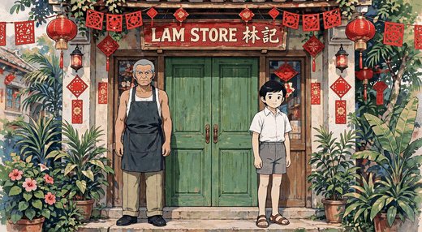
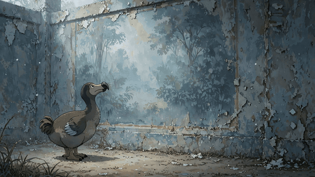

# Cutaway

**An AI film crew. Meta's models plan, paint, direct and review; video models only animate.**

Video models drift. Asked for a whole film, they change the main character between shots, invent scenery and lose the story. Cutaway never asks a video model for a film. It works like a small studio:

- the **director** (Muse Spark) turns a story into a shot list;
- the **painter** (Muse Image) paints every shot as a still, from character sheets;
- a **continuity supervisor** (Muse Spark again) checks every still before any video money is spent;
- the **animator** (an image-to-video model) brings each still to life;
- the **director** watches every take, rejects the weak ones and rewrites their prompts;
- a **critic** (Muse Wonder) watches the finished cut.

Characters stay on-model across the whole film, every take is reviewed, and a hard spending cap is checked against the provider's real bill.

It started with a creator on a small island, with a laptop and no budget, who wanted to tell a story about their own place.

## Films made with Cutaway

| | Film | How it was made |
|---|---|---|
| <a href="films/55_spring_festivals/"></a> | **[55 Spring Festivals · 五十五个春节](films/55_spring_festivals/)** (3:59). One shop, one family and 55 years between China and Mauritius. Team Proxima's entry for the China-Mauritius AI Storytelling and AI Video Clip Competition 2026, made in one day at the bootcamp. Made with teammates Seeya Awotar ([seeya0611](https://github.com/seeya0611)) and Yorvan Rengasamy ([yorvan2401](https://github.com/yorvan2401)). | Muse Image keyframes (3 candidates each, Muse Spark picks), animated by **FLUX 3 Max**, every take reviewed by Muse Spark; ElevenLabs score and voices. fal spend: $32.68 |
| <a href="films/dodo/"></a> | **[The Dodo Came Back](films/dodo/)** (2:04). The dodo returns to a Mauritius that no longer has a place for it. MFDC National Short Film Competition 2026, AI category, theme "What If the Dodo Returns?" | Muse Image keyframes animated by **Wan 3.0** (Kling 2.6 where Wan failed twice), every take reviewed by Muse Spark, upscaled with Real-ESRGAN; Muse Wonder critiqued the cut over seven versions. fal spend: $44.21 |

## How it works

```
story ──► plan ──► character ──► keyframes ──► continuity ──► motion ──► video ──► take ──► cut ──► sound ──► critique
          Muse     sheets        Muse Image    check          prompts    model     review   ffmpeg  score,   Muse
          Spark    Muse Image                  Muse Spark     Muse       (Wan,     Muse             voices   Wonder
                                    ▲                │        Spark      Kling,    Spark
                                    └── repaint ◄────┘                   FLUX)       │
                                                                ▲                    │
                                                                └──── retake ◄───────┘
```

1. **Plan (Muse Spark).** The story becomes a shot list: each shot's keyframe description, camera move, action, sound and transition.
2. **Character sheets (Muse Image).** One sheet per character and per age. An older version of a character is painted by editing the younger sheet, so a face stays the same across decades.
3. **Keyframes (Muse Image + Muse Spark).** Every shot's start frame, plus an end frame where the move must land, painted from the sheets. A shot that has to cut with another is painted from that shot's keyframe, so place and light carry across the cut. Muse Spark checks each frame against the prompt and the sheets, and frames below 7/10 are repainted with its notes. If the content filter refuses a prompt, Muse Spark rewords it.
4. **Motion prompts (Muse Spark).** One motion prompt per shot, written with the whole film in view so shots lead into each other: the camera move, ordered action beats, the environment's motion and a sound line.
5. **Video (image-to-video model).** The animator only moves what the keyframe already shows. Wan 3.0 and Kling 2.6 made the dodo film; FLUX 3 Max made *55 Spring Festivals*, sound effects and on-camera speech included.
6. **Take review (Muse Spark, video input).** Muse Spark watches every take next to its keyframe and scores it. It names the problems (morphing faces, invented scenery, extras popping in) and rewrites the prompt for a retake. The first takes of every shot come before any retakes, and retakes go to the worst shots first, within the budget.
7. **Cut, sound and critique.** ffmpeg assembles the chosen takes. Muse Spark writes the music and sound design, and fal's audio models (ElevenLabs Music, Eleven v3, sound effects) perform them. Muse Wonder watches and hears the whole cut and gives notes per shot.
8. **Disclosure.** Every model call, prompt, take, review and cost is logged, and the AI-use report each competition requires is written from that log.

## Two pipelines

**`cutaway/director.py`** is the full pipeline, used for *The Dodo Came Back*. A film is a folder with `story.md` and `refs.json`; see `films/dodo/`.

```
python -m cutaway.director films/dodo plan               # shot list
python -m cutaway.director films/dodo keyframes          # paint + continuity check
python -m cutaway.director films/dodo storyboard         # contact sheet of keyframes
python -m cutaway.director films/dodo motion             # Muse Spark plans every shot's motion, as one film
python -m cutaway.director films/dodo i2v                # takes, reviews and retakes, within the budget
python -m cutaway.director films/dodo upscale            # chosen takes to 1920x1080 (Real-ESRGAN)
python -m cutaway.director films/dodo cut --source i2v --final
python -m cutaway.director films/dodo score              # sound design and score
python -m cutaway.director films/dodo critique --source i2v   # Muse Wonder watches and hears the cut
python -m cutaway.director films/dodo notes --audio note.m4a  # the director's spoken notes become shot changes
python -m cutaway.director films/dodo disclosure         # AI-use report
```

**`cutaway/bootcamp.py`** is a fast pipeline for a time-boxed session, used for *55 Spring Festivals*. All AI work had to happen within a few hours on the day. The plan is one JSON file (see [film.json](films/55_spring_festivals/film.json)), and every stage runs its shots in parallel.

```
python -m cutaway.bootcamp sheets                 # character sheets, older ages painted from younger ones
python -m cutaway.bootcamp keyframes              # 3 candidates per frame, Muse Spark picks the best
python -m cutaway.bootcamp quote                  # what the next takes will cost; spends nothing
python -m cutaway.bootcamp video --yes            # FLUX 3 Max, all clips at once, under the hard cap
python -m cutaway.bootcamp review                 # Muse Spark scores every take and rewrites weak prompts
python -m cutaway.bootcamp cut
python -m cutaway.bootcamp score --yes            # ElevenLabs Music timed to the cut
python -m cutaway.bootcamp voice --yes            # ElevenLabs v3 voice lines
python -m cutaway.bootcamp_final timeline         # title, photo inserts, end card, credits
python -m cutaway.bootcamp_final render           # bilingual captions and subtitles, mix, MP4
```

What we learned about prompting FLUX 3 Max is in [docs/FLUX3_PLAYBOOK.md](docs/FLUX3_PLAYBOOK.md), and lessons from both films are in [docs/LESSONS.md](docs/LESSONS.md).

## Models used

| Model | Job |
|---|---|
| `muse-spark-1.3` (Meta) | Shot planning, keyframe continuity checks, motion prompts, every take's review and retake prompt, rewording after filter refusals, sound design and score plans, interpreting the director's voice notes |
| `muse-image-1.0` (Meta) | Character sheets (and their ageing), every keyframe |
| `muse-wonder-1.0` (Meta) | Watching and hearing the full cut, notes per shot |
| `muse-voice-transcribe-1.0` (Meta) | The director's spoken notes, with the film's place names as keyword bias |
| `sam-3.1` (Meta) | Depth layers for the 2.5D Blender pipeline (below) |
| Wan 3.0, Kling 2.6 Pro, FLUX 3 Max (via fal.ai) | Animating keyframes |
| ElevenLabs Music, Eleven v3, sound effects (via fal.ai) | Score, voices, sound |

## Design choices

- **Keyframes first.** A repaint costs a cent and a video take costs about a dollar, so every frame is checked before it's animated. The video model never has to invent a character or a place.
- **The model decides, the code does the mechanics.** Muse Spark chooses moves and writes prompts. Code holds the budget, picks takes, decides what gets redone and assembles the film.
- **Check everything that can be checked.** Keyframes against character sheets, takes against keyframes, the cut against the story, and one model's notes are never allowed to discard work on their own (see [LESSONS.md](docs/LESSONS.md)).
- **Hard spend cap, checked against the real bill.** Each paid call reserves its worst-case cost before it's sent and settles afterwards. The ledger is reconciled with the provider's usage records after every clip; on the dodo film fal billed twice its list price, which is why the ledger now follows the real bill rather than the price list.
- **A paid request is never lost.** The request ID is saved before waiting, and a crash, a dropped wifi connection or a sleeping laptop resumes the request instead of paying again.
- **Resumable.** Each shot keeps its own state file, so a crash, a budget stop or a change to one shot only redoes what depends on it.

## The 2.5D Blender pipeline

Cutaway began as a 2.5D animation studio. Instead of a video model, it cuts each painted still into depth layers and films them with a real virtual camera in Blender. A shot can be as long as the story needs, a character never changes, and it costs a few dollars of API calls. The first versions of the dodo film were made this way. The final cut moved to image-to-video because the video models gave the dodo more natural motion.

```
keyframes ──► layers ──► specs ──► render ──► review
              SAM 3.1    camera     Blender    Muse Spark
              + Muse     fitting    (Eevee)    watches each shot
              Image
              clean plate
```

- **Layers (SAM 3.1 + Muse Image).** SAM cuts out every character, its head, the ground and the foreground. Muse Image paints a clean plate without them, and SAM checks they're really gone. Each character becomes a bendable puppet: one mesh with a weight map, so a neck curves instead of hinging.
- **Specs (code).** "Push in, strong, rack focus to the subject" becomes an exact camera path, shifted or scaled until the character stays in frame and the camera never sees past the painting's edge.
- **Render (Blender).** Image layers at their depths, depth of field, handheld shake, puppet bends, contact shadows, wind in plants, fog, light motes and camera flashes.

```
python -m cutaway.director films/dodo produce        # layers, specs, render, review, re-render
python -m cutaway.director films/dodo exploded --shots s07_waterfront_pouce   # making-of layer view
```

Add `--shots id1,id2` to work on some shots, `--preview` to render three stills per shot, and `--final` for 1920×1080.

## Setup

Requirements: Python 3.12+, ffmpeg, a Meta Model API key, a fal.ai key for the video and audio models, and Blender 5.x for the 2.5D pipeline only.

```
python -m venv .venv
.venv/Scripts/python -m pip install -r requirements.txt
copy .env.example .env          # add MODEL_API_KEY and FAL_KEY
```

## Layout

- `cutaway/director.py`: the full pipeline and its stages
- `cutaway/animate.py`: motion planning, takes, reviews and retakes for image-to-video
- `cutaway/i2v.py`: video and audio models on fal.ai, with the spend cap, real-bill reconciliation and resumable requests
- `cutaway/bootcamp.py`, `cutaway/bootcamp_final.py`: the one-day pipeline and its final edit
- `cutaway/meta.py`: Meta Model API client (chat with video, images, SAM, transcription) with the spend cap and generation log
- `cutaway/keyframes.py`, `cutaway/sheet.py`: keyframes and character sheets that recover from content-filter refusals
- `cutaway/score.py`, `cutaway/sound.py`, `cutaway/edit.py`: sound design, score, mixing, assembly, end cards
- `cutaway/camera.py`, `cutaway/puppet.py`, `cutaway/blender_shot.py`: the 2.5D Blender pipeline
- `cutaway/makingof.py`, `experiments/`: the making-of video and the proofs that led here

## History

Built for the Meta Global AI Developer Hackathon (Oct 27 – Nov 4, 2026), track **Build for Your World**. The 2.5D Blender pipeline and the image-to-video pipeline that made the dodo film were written during the hackathon. The one-day pipeline (`cutaway/bootcamp.py`, `cutaway/bootcamp_final.py`, and the FLUX 3 Max and ElevenLabs support in `cutaway/i2v.py`) was added afterwards, for the China-Mauritius AI Video Bootcamp on 21 November 2026.

## Credits and licence

Code: MIT. Third-party photos, sounds and fonts are listed with their licences in [CREDITS.md](CREDITS.md).
