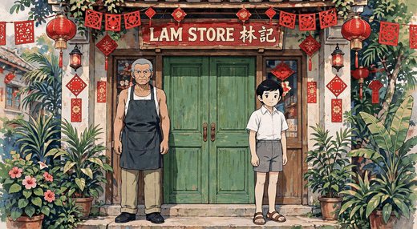
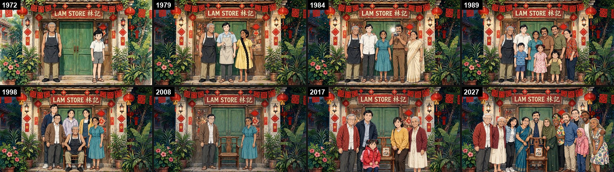
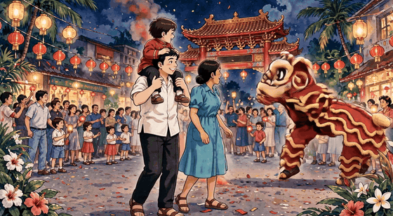
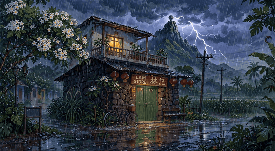
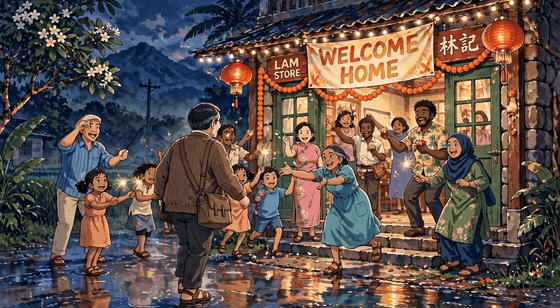
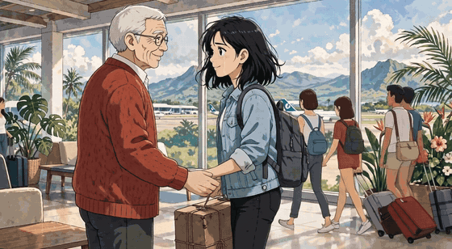
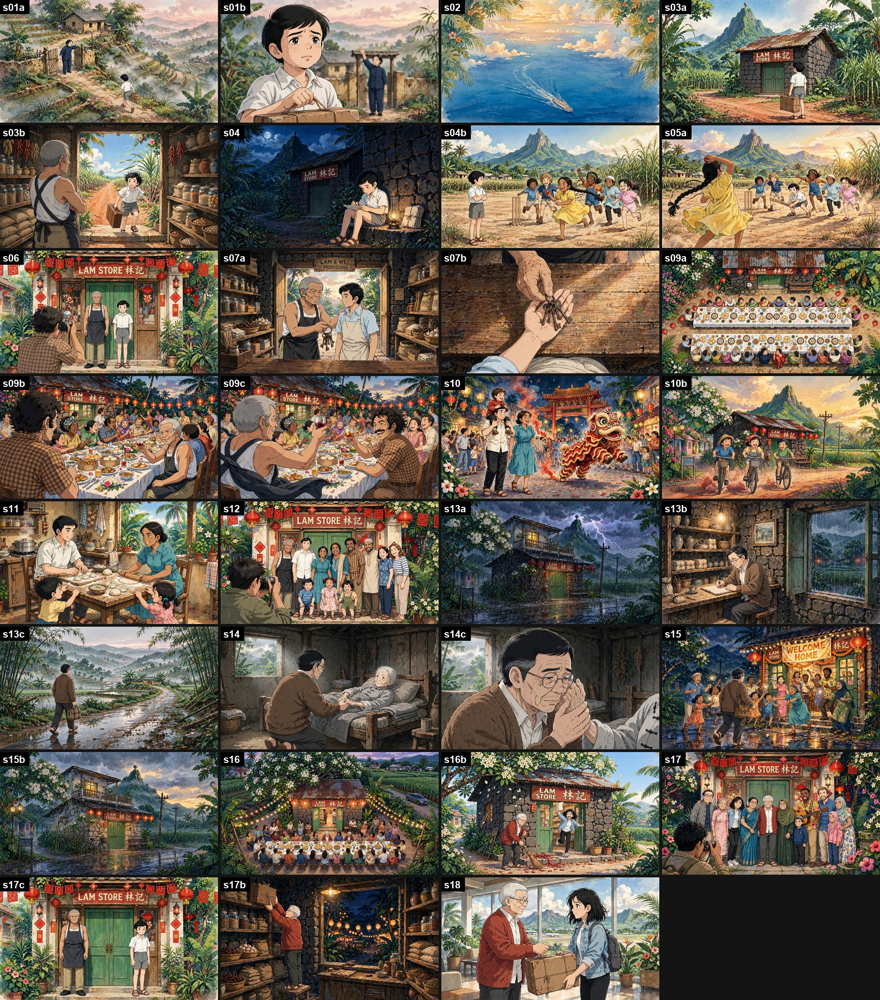
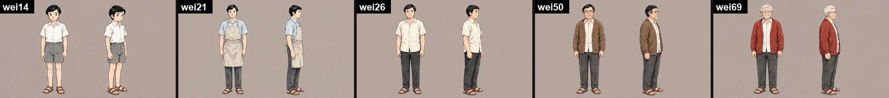
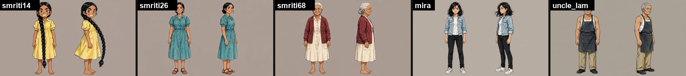

# 55 Spring Festivals · 五十五个春节

**A 4-minute AI film about one shop, one family and 55 years between China and Mauritius.**

Team **Proxima** (Middlesex University) made it in one day at the **China-Mauritius AI Storytelling and AI Video Clip Competition 2026** bootcamp (21 November 2026, Ebène) for the theme *"Touching Stories of the Ordinary People of China and Mauritius in the Journey of 55 Years"*.

  

### ▶ [Watch the film (MP4, 3:59)](media/55_Spring_Festivals_RNA_team.mp4)

English dialogue with Chinese subtitles.

---

## The story

In **1972**, fourteen-year-old **Wei** leaves Meizhou, a Hakka town in Guangdong, with a string-tied cardboard suitcase. He arrives in Mauritius at his uncle's basalt-stone shop, **LAM STORE 林記**, among the sugar cane under the Pieter Both mountain. He is homesick until **Smriti**, the girl from across the road, pulls him into a game with the neighbourhood kids.

Every Spring Festival, Smriti's father takes a photo in front of the shop. In 1979 the keys pass to Wei: *"Take care of this street, and it will take care of you."* He marries Smriti in 1984, and the whole street comes to the wedding. Children run through the shop. In 2008 a phone call takes him back to China and to his dying mother: *"Home is where your children laugh. Go back to them."* He comes home to find the street waiting with every light on.

By the 55th Spring Festival, the photo needs a wider lens. His granddaughter **Mira** wins a scholarship to China, and at the airport he hands her the same cardboard suitcase: *"It brought me here. Let it bring you back."*

**55 years. Two homes. One family.**

The story, characters and dialogue are adapted from the team's own stage-1 comic. None of the comic's artwork was reused: every image and clip was generated from scratch during the bootcamp.

## The 55 photographs

The yearly photo at the shop door is the film's spine. Each photo flash cuts to the next era, and the climax morphs through 55 years of photos in one locked-off shot. In it, the boy becomes a grandfather, the uncle's chair stands empty, and the street fills up.

<table>
  <tr>
    <td></td>
    <td></td>
  </tr>
  <tr>
    <td></td>
    <td></td>
  </tr>
</table>

## Storyboard

The first frame of each of the 31 shots, in film order:

## Characters

Wei at 14, 21, 26, 50 and 69. Each older version was painted by editing the younger one, so his face stays the same across 55 years.

## How it was made

The film was made with **Cutaway**, the AI film pipeline in this repository. It works like a small film crew:

| Role | Model | What it did |
|---|---|---|
| Painter | **Meta Muse Image** | Character sheets for every age, then the start and end keyframes of every shot (about 565 images, 3 candidates each) |
| Critic | **Meta Muse Spark** | Scored every keyframe against the character sheets, then watched every video take and rewrote the weak prompts |
| Animator | **FLUX 3 Max** (Black Forest Labs, via fal.ai) | Animated every shot from its keyframes, with its sound effects and on-camera dialogue |
| Composer | **ElevenLabs Music** (via fal.ai) | One score for the whole film, from a composition plan timed to the cut |
| Voices | **ElevenLabs Eleven v3** (via fal.ai) | The narration and the off-screen lines (the phone call, the video call) |
| Editor | **ffmpeg** (non-AI) | Cut, photo-flash transitions, bilingual captions and subtitles, mix, export |

Claude (Anthropic) wrote the pipeline code and the prompts with the team, adapted the comic into a shot list, and translated the Chinese subtitles.

The day ran like this: plan → character sheets → keyframes (with Spark's review loop and the team's critiques) → one paid test clip → all clips in parallel → Spark reviews the takes and the team gives notes → retakes → score and voices → final edit.

- **Spend:** $32.68 on fal.ai, from $60 pooled by the team. A hard cap in the code was checked against fal's real bill after every clip. About $11.50 went on the Meta Model API.
- **Disclosure:** every AI tool is disclosed in [AI_CREATION_STATEMENT.md](AI_CREATION_STATEMENT.md). The film uses no outside music or sound.

## Files

| Path | What it is |
|---|---|
| [media/55_Spring_Festivals_RNA_team.mp4](media/55_Spring_Festivals_RNA_team.mp4) | The film |
| [film.json](film.json) | The production plan: characters, the 31 shots, every image and motion prompt, the dialogue |
| [media/keyframes/](media/keyframes/) | The final keyframe of every shot |
| [media/characters/](media/characters/) | Character sheets |
| [AI_CREATION_STATEMENT.md](AI_CREATION_STATEMENT.md) | Tools, AI and manual shares, disclosures |
| [../../cutaway/bootcamp.py](../../cutaway/bootcamp.py) | The pipeline: plan, sheets, keyframes, video, review, cut, score, voice, mix |
| [../../cutaway/bootcamp_final.py](../../cutaway/bootcamp_final.py) | The final edit: cards, photo inserts, captions, subtitles, mix |
| [../../docs/FLUX3_PLAYBOOK.md](../../docs/FLUX3_PLAYBOOK.md) | What we learned about prompting FLUX 3 Max |
| [../../docs/BOOTCAMP_FILM.md](../../docs/BOOTCAMP_FILM.md) | The original story and shot plan |

## Team Proxima

Mikhil Naika (team leader) · Seeya Awotar · Yorvan Rengasamy, Middlesex University.

### Thank you

A big thank you to my teammates **Seeya Awotar** ([seeya0611](https://github.com/seeya0611)) and **Yorvan Rengasamy** ([yorvan2401](https://github.com/yorvan2401)). *55 Spring Festivals* began as our stage-1 comic, and we wrote its story, characters and dialogue together. On bootcamp day they critiqued every keyframe and every take with me, pushed for the scenes that make the film (Wei's goodbye to his mother, the 55 photos, the ending), and helped pay for the video generation. This film is theirs as much as mine.

The film was generated during the bootcamp for the China-Mauritius AI Storytelling and AI Video Clip Competition 2026. The organisers hold non-commercial rights to exhibit and promote it.
